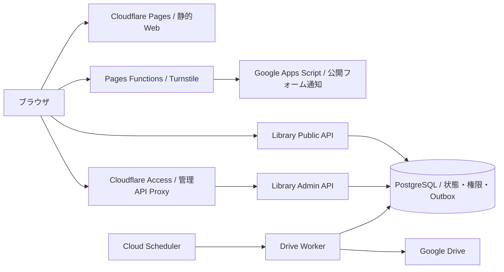

# COMPASS Platform

**Don’t Just Learn. Build What’s Next.**
**学びを、意思決定の力へ。**

[公開Web](https://compass-official.pages.dev/) · [開発に参加する](#開発に参加する方へ) · [アーキテクチャ](#アーキテクチャ) · [文書索引](docs/README.md) · [利用許可](#ライセンスと利用許可)

COMPASS Platformは、主に北里大学の学生に向けて、学習・進路・コミュニティを横断したデジタル体験を提供する、学生主導型の教育・テクノロジープラットフォームである。北里大学および同大学の学部・研究室・関連機関の公式組織・公式サービスではない。

このリポジトリは、3D空間を取り入れた公式Webサイト、Contact・Communityの公開フォーム、未来戦略ライブラリの登録基盤（API・データベース・インフラ）と、その開発・検証の仕組みを管理する。COMPASS Interactiveのアプリケーション本体は、別のリポジトリ・別の環境で開発している。

## 開発に参加する方へ

開発に参加するときは次の3つを順に読み、作業のたびに関係する節を確認すること。AI agentも同じ文書に従う。

1. [チーム開発ルール](docs/team-development.md)：役割、変更の区分、branch、review、merge、本番公開
2. [CONTRIBUTING](CONTRIBUTING.md)：開発環境の用意から最初のPRまで
3. [AGENTS.md](AGENTS.md)：作業範囲、編集・検証・承認の規則

そのほかの文書は[文書索引](docs/README.md)にまとめている。

## アーキテクチャ

公開ページは静的に配信し、利用者の入力を受ける処理だけをCloudflare Pages Functionsと登録基盤のAPIに分ける。

各サービスの役割は[Architecture](docs/ARCHITECTURE.md)にある。

### 実行環境

| 環境 | 実行場所 | 構成 | 状態 |
|---|---|---|---|
| 公式Web | Cloudflare Pages（`compass-official`） | Next.jsのstatic export。`main`へのmergeがProduction配信を起動し得る | `Production` |
| 公開フォーム（Contact・Community） | Cloudflare Pages Functions → Google Apps Script | Turnstileと入力検証の後、GASが通知メールを送る。問い合わせ本文と登録内容をデータベースに保存しない | ページは`Production`で配信中。Turnstile・GAS・Secretの外部設定は各runbookでoperatorが確認する |
| 未来戦略ライブラリ登録基盤 | Google Cloud Run · Neon PostgreSQL | Public API、Admin API、Drive Worker、Migration Jobを分離 | `Implemented, verification pending`。本登録のroute・APIは未公開（[Phase Roadmap](docs/library-registration/phase-roadmap-v3.md)） |
| COMPASS Interactive本体 | 別のリポジトリ・別の環境 | — | このリポジトリの対象外 |

Interactive紹介などの独立した編集範囲も同じNext.jsの成果物から配信するが、COMPASS公式サイトとは編集の範囲を分けている（[Website Boundaries](docs/WEBSITE_BOUNDARIES.md)）。

### ディレクトリ構成

| パス | 内容 |
|---|---|
| [`src/app/`](src/app/) | 公式Web、Interactive紹介、Library関連のroute |
| [`src/components/Habitat/`](src/components/Habitat/) | 3D描画、セクション制御、メディア・音声処理 |
| [`scripts/habitat/`](scripts/habitat/) / [`scripts/contact-entry/`](scripts/contact-entry/) | 3D・映像アセットの生成、変換、検証 |
| [`src/library-registration/`](src/library-registration/) | Library登録・管理UI、APIクライアント |
| [`functions/`](functions/) | Contact・Community、管理API Proxy、ドメインルーティング |
| [`services/library-api/`](services/library-api/) | FastAPI、Drive Worker、Migration、Pythonテスト |
| [`infra/library-registration/`](infra/library-registration/) | Terraform、Cloud Run、IAM、Secret Manager、Scheduler |
| [`google-apps-script/`](google-apps-script/) | Contact・Communityの通知処理 |
| [`tests/`](tests/) | フロントエンド、レスポンシブ、3D、配信まわりのテスト |
| [`.github/workflows/`](.github/workflows/) | CI、セキュリティチェック、依存関係の監査 |
| [`docs/`](docs/) | 方針、設計、運用手順の文書 |

公式トップは `src/app/(official)/page.tsx` → `src/App.tsx` → `src/LegacyPageBody.tsx` の順に描画される。`LegacyPageBody.tsx` は名称に反して現行の実装である。

## ブラウザで描く3D空間

公式トップのHabitatは、Three.jsのWebGL描画とHTMLのUIで構成する。9つのセクションに対応する空間とカメラを、1つのレンダラーで連続して描く。

- 文章、リンク、見出し、フォームは既存のcomponentが通常のDOMとして持ち、3Dはその背後の空間として描く。3Dが動かない環境でも、内容と遷移先は変わらない。
- 3Dは、画面幅901px以上で精密なポインターを持つ端末と、901px以上の横向きタブレットで有効にする。縦向きのタブレットとスマートフォンは静的なレイアウトを使う。端末の種類で画質を下げないため、条件を満たす端末では同じシーンを描く。
- Reduced Motionでは各セクションの静止画を使い、3Dエンジンとモデルを読み込まない。GLBの読み込み失敗、WebGLの欠如、コンテキストの喪失、3秒間の計測が2回続けて28fpsを下回った場合も、静止画とHTMLに切り替える。
- 建築と家具はBlenderで制作し、間接光をライトマップに焼き込む。ランタイムではPBR材質、HDR環境光、反射、Bloomを使い、glTF/GLBはMeshopt、画像はWebPで圧縮する。
- 音は利用者の操作の後にだけ、ブラウザ内で合成して鳴らす。自動再生、マイク、音声ファイルの取得はない。非表示のタブでは消音する。

実装は[Habitat](src/components/Habitat/)、設計は[Parent Desktop habitat](docs/parent-habitat-3d.md)、制作手順は[Authoring Guide](scripts/habitat/README.md)、素材の出典は[Asset Credits](scripts/habitat/ASSET_CREDITS.md)にある。通常のWebビルドにBlenderは要らない。

## モバイルと映像

- 縦向きのタブレットとスマートフォンでは、NASAが撮影・公開した国際宇宙ステーションからの写真とタイムラプスを使う。AIによる生成、補間、架空の天体は使わない。
- 動画は表示領域と通信状態に応じて読み込みと再生を制御し、データ節約設定、低速回線、再生の失敗では静止画に切り替える。モバイルでは3DエンジンとGLBを読み込まないことをテストで確かめている。
- Contactの入口では、Blenderで制作した建物の映像の扉にHTMLのボタンを重ね、選んだ部屋へ映像で移る。映像は選択の後にだけ読み込む。演出は飛ばせて、Reduced Motionや読み込みの失敗でも同じフォームに着く。

詳細は[Mobile Space Media](docs/mobile-space-media.md)と[Contact Door Entry](docs/contact-door-entry.md)にある。

## 公開フォーム

ContactとCommunityの参加申請は、Next.jsの静的ページとCloudflare Pages Functionsで受け付け、Google Apps Scriptが通知メールを送る。

- 送信はTurnstileとサーバー側の入力検証を通った場合だけGASへ渡す。
- ContactとCommunityは、endpoint、入力のschema、Turnstileのkeyとaction、GASのプロジェクト、共有シークレット、メールの流れを分け、明示的なarchitectureの変更なしに統合しない（[Architecture](docs/ARCHITECTURE.md)の「Form Isolation」）。
- どちらもデータベースを使わない。Contactでは、GASが一時的に持つのは10分間のメール確認の状態、レート制限、送信の冪等性の情報だけで、確認コード、メールアドレス、IPアドレスは平文で保存せず、必要な識別値だけをHMAC化する。

設定と運用の手順は[Contact Form Operations](docs/contact-form-operations.md)と[Community Registration Operations](docs/community-registration-operations.md)にある。

## 未来戦略ライブラリ登録基盤

状態は`Implemented, verification pending`である。設計と実装はローカルと合成データで検証済みで、本登録のroute・APIの公開、billing、Terraform applyは未実施である。判定の正本は[Phase Roadmap](docs/library-registration/phase-roadmap-v3.md)にある。

FastAPI、Neon PostgreSQL、Google Cloud Runを中心に構成し、Public API、Admin API、Drive Worker、Migration Jobを分けて、それぞれに必要な権限だけを持たせる。

| 仕組み | 防ぐこと |
|---|---|
| Google Driveへの権限の反映を、Transactional OutboxでWorkerへ渡す | データベースの更新とDriveの権限の食い違い |
| WorkerはCloud SchedulerからOIDC付きで起動し、Lease・Retry・操作署名を確かめてから実行する | 二重実行と、途中で失敗した処理の取り残し |
| サービスごとにデータベースのロールを分け、権限の境界をまたぐ処理はRPCに寄せる | 権限外の表の操作 |
| Google IDトークンと管理者権限をサーバー側で判定する | 画面の表示だけに頼った認可 |
| 管理APIはCloudflare Access、共有シークレット、データベースの権限を重ねる | 1つの防御を破られただけで行える管理操作 |
| Secret Managerで接続情報を用途ごとに分け、各サービスには必要なSecretだけを渡す | 1つのサービスからの全認証情報の漏えい |
| 管理操作、権限の変更、エクスポートを監査ログに記録する | 誰が何を変えたか追えないこと |

インフラはTerraformで定義し、Migration、Public API、Admin API、Drive処理を個別に有効にできる。管理APIの認可設計は[Admin Access Security Boundary](docs/library-registration/admin-access-security-boundary.md)にある。

## 品質と検証

| 段階 | 実行する検査 |
|---|---|
| PRの必須check `CI result` | repositoryの契約、公開ソースの境界、型検査、unit test、lint、static exportのbuildと検証（`npm run verify`） |
| PRの必須check `Library security result` | 公開ソースとGit履歴のsecret scan、依存の差分review。Library・フォームに関係するpathを変えたときは、Library成果物のrehearsalとAPI testを加える |
| 週1回の`Repository Maintenance` | npm・uvの依存の脆弱性監査とSBOM |
| 手元またはcloud | `npm run check`：フォームのテスト、型検査、build、static exportの検証、全公開routeのPlaywrightによるレスポンシブ検査とHabitatの検証 |
| Cloudflare Preview | PRごとの実表示の確認。Web UIの変更は、この確認までを1つの作業とする |
| Windows host | 画像差分（visual regression）。基準画像はWindowsで作るため、CIとcloudでは実行しない |

テストにはVitest、Pytest、Playwright、Node.js Test Runnerを使う。どの検査をいつ実行するかは、変更の区分とリスクに応じて[Agentの検証とPreview完了契約](docs/agent-delivery-policy.md)で選ぶ。3Dの描画性能や実際の外部サービスへの接続など、CIで確かめられない項目は、Previewでの目視の確認で補う。

## セキュリティと個人情報

公開フォームと登録基盤は、氏名、メールアドレス、学籍番号、問い合わせ本文などの個人情報を扱う。そのため、secret・個人情報・保護されたLibrary資料をリポジトリ、log、analyticsに含めない規則と、それを検出する検査（公開ソースの境界、Git履歴のsecret scan）を設けている。規則は[AGENTS.md](AGENTS.md)の「Security and Privacy」、脆弱性の報告方法は[Security Policy](.github/SECURITY.md)にある。

## 開発

開発環境の用意と最初のPRまでの手順は[CONTRIBUTING](CONTRIBUTING.md)にある。開発とmock buildに本番の認証情報は要らない。

| 環境 | 特徴 | セットアップ |
|---|---|---|
| Claude Code cloud（既定） | claude.ai/codeのCOMPASS専用環境。session開始時にNode・uvの固定版、依存、Playwrightが揃う | 環境`compass`のsetup script（[Cloud Development](docs/CLOUD_DEVELOPMENT.md)） |
| Codex Cloud | Codexによる非同期の実装とreview | `bash .codex/setup.sh` |
| GitHub Codespaces / Dev Container | Docker、Library用PostgreSQL、Terraformの作業 | [Open in GitHub Codespaces](https://codespaces.new/genellect/compass?quickstart=1) |

どの環境も`npm run dev:doctor`で準備を確かめ、`npm run dev:cloud`で開発サーバーを起動する。環境・依存・保守ツールを変えたときは`npm run check:repository`、広い範囲の変更では`npm run check`を実行する。Windows PowerShellから直接実行するときは`npm.cmd run`と読み替える。

API、専用ローカルDB、E2Eの手順は[Development Workflows](docs/development-workflows.md)、依存の更新と監査は[Dependency Maintenance](docs/dependency-maintenance.md)にある。

## 技術スタック

バージョンはこのリポジトリの依存定義に対応する。配信済みのバージョンはデプロイ先のコミットで確かめる。

| 領域 | 技術と用途 |
|---|---|
| Web | Next.js 16.4 · React 19 · TypeScript 5.9 · Zod 4 · Static Export |
| 3D | Three.js 0.185 · WebGL 2 · glTF/GLB · Meshopt · PBR · HDR · 焼き込みライトマップ |
| 素材制作 | Blender 4.5 LTS · Open Image Denoise · glTF Transform 4.5 · FFmpeg · WebP/H.264 |
| 音・操作 | Web Audio API · Native DOM · Pointer / Keyboard · Reduced Motion |
| Edge配信 | Cloudflare Pages · Pages Functions · Turnstile · Cloudflare Access |
| API・認証 | Python 3.12–3.13 · FastAPI · Pydantic 2 · Uvicorn · Google Identity Services / OpenID Connect |
| データ | PostgreSQL 17 · Neon · SQLAlchemy 2 · Psycopg 3 · Alembic |
| 権限処理 | Google Drive API · Transactional Outbox · Lease / Retry · Operation Attestation |
| 実行環境・IaC | Google Cloud Run / Jobs · Cloud Scheduler · Secret Manager · Terraform · Docker Compose |
| 通知・計測 | Google Apps Script · Google Analytics 4 · Cloudflare Web Analytics |
| 検証 | Vitest · Pytest · Playwright · Node.js Test Runner · CodeQL · npm Audit · OSV |
| 開発環境 | Claude Code cloud · Codex Cloud · GitHub Codespaces · Dev Containers · npm / uv lockfiles |

正確な解決バージョンは[package-lock.json](package-lock.json)と[uv.lock](services/library-api/uv.lock)、ツールの固定値は[toolchain.env](.devcontainer/toolchain.env)にある。

## ライセンスと利用許可

Copyright © 2026 **Yuto Matsui**. All rights reserved.

本リポジトリは、ソースコードの閲覧および技術評価を目的として公開しています。

**商用利用、改変、再配布には、事前の書面による許可が必要です。** 非営利目的の場合も同様です。詳細な利用条件は[LICENSE](LICENSE)、利用許可に関する案内は[Permissions](docs/legal/permissions.md)を参照してください。

第三者のOSS、写真、映像、その他の素材には、それぞれのライセンスおよび利用条件が適用されます。出典とライセンス情報は[Third-party Notices](THIRD_PARTY_NOTICES.md)および[Asset Register](docs/legal/asset-register.md)に記載しています。

セキュリティ上の問題を発見した場合は、[Security Policy](.github/SECURITY.md)に従って報告してください。
